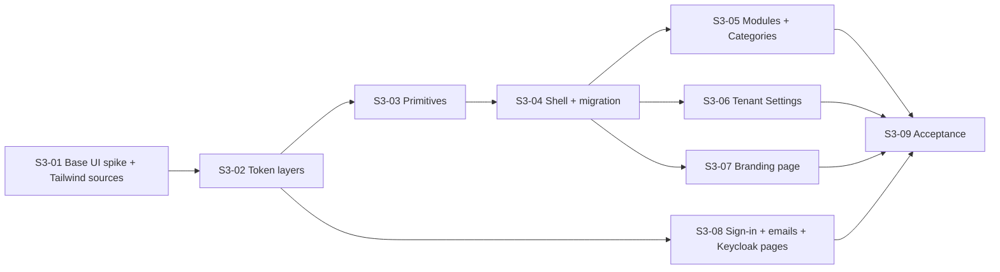

# Spec 3 ticket breakdown

Spec: [Shell, branding and design system](../../specs/03-shell-branding-and-design-system.md), re-approved 2026-10-22. Beads epic: `genie-ops-center-v2-6wz1`. The owner approved this breakdown on 2026-10-22. Beads owns live status, claims and blockers. These documents own ticket scope and acceptance.

## Definition of done for every ticket

- The ticket's acceptance criteria pass at a phone and a desktop viewport for every screen (`DEC-25`, amended 2026-10-22).
- For UI: documented Storybook stories first, then failing behavior tests, then the code ([UI development workflow](../../architecture/ui-development.md)). Each story matches its design capture.
- The anti-slop browser scan (`npx impeccable detect`) is clean on every story the ticket touched.
- axe passes on every end-to-end screen the ticket touched.
- `pnpm gate:merge` is green before the merge.

## Tickets

| Ticket | Bead | Depends on | Folded beads | Title |
| --- | --- | --- | --- | --- |
| [S3-01](01-base-ui-spike-and-tailwind-sources/index.md) | `6wz1.3` | none | `crg7`, `ghe` | Base UI spike and app Tailwind sources |
| [S3-02](02-token-layers/index.md) | `6wz1.4` | S3-01 | `u4nq` | Fixed and tenant token layers |
| [S3-03](03-primitives-and-shared-parts/index.md) | `6wz1.5` | S3-02 | none | Primitives and shared parts, replacing the core kit |
| [S3-04](04-shell-navigation-and-migration/index.md) | `6wz1.6` | S3-03 | `1ri3` | Shell, navigation tree and the Section 3 migration |
| [S3-05](05-modules-and-categories-pages/index.md) | `6wz1.7` | S3-04 | `4xz` | Modules and Categories pages |
| [S3-06](06-tenant-settings-and-configform/index.md) | `6wz1.8` | S3-04 | none | Tenant Settings and ConfigForm |
| [S3-07](07-branding-page/index.md) | `6wz1.9` | S3-04 | none | Branding page |
| [S3-08](08-sign-in-emails-and-keycloak-pages/index.md) | `6wz1.10` | S3-02 | `6wz1.2` | Sign-in branding, email templates and Keycloak pages at phone width |
| [S3-09](09-section-3-acceptance/index.md) | `6wz1.11` | S3-05, S3-06, S3-07, S3-08 | none | Section 3 acceptance |

Item 7 (personal Preferences), settings search and reintroduction review are deferred by the 2026-10-22 revision. Record navigation and record categories moved to Section 4.

## Order

S3-01 to S3-04 run one after another. S3-08 can start after S3-02. S3-05, S3-06 and S3-07 can run in parallel after S3-04.
