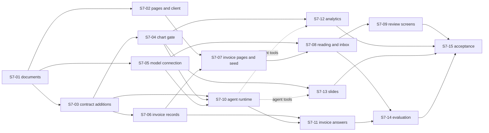

# Spec 7 ticket breakdown

Spec: [Invoice and payments, with chat, dashboards and slides](../../specs/07-invoice-and-payments.md), draft 2026-10-27. Technical plan: [07-invoice-and-payments.md](../../tech-plans/07-invoice-and-payments.md). Beads epic: `genie-ops-center-v2-czjw`. The owner approved this breakdown on 2026-10-27, after a cold critique of the plan and of the tickets. No ticket after S7-01 starts before the owner approves the spec. Beads owns live status, claims and blockers. These documents own ticket scope.

Owner decision, 2026-10-27: full scope for the November 2026 festival, with no slip order.

## Definition of done for every ticket

- The ticket's acceptance criteria pass at a phone and a desktop viewport for every screen (`DEC-25`).
- For UI: documented Storybook stories first, then failing behavior tests, then the code ([UI development workflow](../../architecture/ui-development.md)).
- Pure rules get unit tests. Anything that reads the database gets integration tests on a real Postgres.
- The anti-slop browser scan (`npx impeccable detect`) is clean on every story the ticket touched.
- axe passes on every end-to-end screen the ticket touched.
- A new dependency gets its `../../core/tech-stack.md` line in the same change.
- Gate and end-to-end tests use the recorded test model of S7-05. No test in `pnpm gate:merge` calls a live model.
- `pnpm gate:merge` is green before the merge.

## Tickets

| Ticket | Bead | Depends on | Folded beads | Title |
| --- | --- | --- | --- | --- |
| [S7-01](01-documents-and-fixtures/index.md) | `czjw.1` | none | none | Section 7 documents and fixtures |
| [S7-02](02-module-pages-and-browser-client/index.md) | `czjw.2` | S7-01, `6wz1.32`, `6wz1.40` | none | Module pages and browser client |
| [S7-03](03-module-contract-additions/index.md) | `czjw.3` | S7-01 | `d8l5.22` | Module contract additions |
| [S7-04](04-chart-gate-and-component/index.md) | `czjw.4` | S7-03 | none | Chart write gate and chart component |
| [S7-05](05-model-connection/index.md) | `czjw.5` | S7-01 | none | Model connection and test model |
| [S7-06](06-invoice-records-and-datasets/index.md) | `czjw.6` | S7-03 | none | Invoice records, matching and datasets |
| [S7-07](07-invoice-pages-tenant-and-seed/index.md) | `czjw.7` | S7-02, S7-06 | `czjw.28` (added 2026-11-01) | Invoice pages, demo tenant and seed |
| [S7-08](08-reading-job-and-inbox/index.md) | `czjw.8` | S7-05, S7-07 | none | Reading job and Documents inbox |
| [S7-09](09-review-screens/index.md) | `czjw.9` | S7-08 | none | Review screens |
| [S7-10](10-agent-runtime/index.md) | `czjw.10` | S7-03, S7-04, S7-05 | none | Agent runtime, Ask and bubble |
| [S7-11](11-invoice-answers/index.md) | `czjw.11` | S7-06, S7-10 | none | Invoice answers |
| [S7-12](12-analytics-module/index.md) | `czjw.12` | S7-04; tools after S7-10 | none | Analytics module |
| [S7-13](13-slides-module/index.md) | `czjw.13` | S7-04; tools after S7-10 | none | Slides module |
| [S7-14](14-evaluation-suite/index.md) | `czjw.14` | S7-08, S7-11 | none | Evaluation suite and model choice |
| [S7-15](15-acceptance/index.md) | `czjw.15` | all | none | Section 7 acceptance |
| [S7-16](16-date-pickers/index.md) | `czjw.66` | none | none | A date picker for every date input |
| [S7-17](17-virtualized-data-table/index.md) | `czjw.70` | none | none | Virtualized DataTable rows |
| [S7-18](18-updated-column-and-server-sort/index.md) | `czjw.71` | none | none | Updated column and sorting in the database |
| [S7-19](19-list-header/index.md) | `czjw.73` | S7-16, S7-17, S7-18 | none | One list header for Invoices, Payments and the Documents inbox |
| [S7-20](20-inbox-tab-counts/index.md) | `czjw.68` | S7-19 | none | Clear counts on the Documents inbox tabs |
| [S7-21](21-inbox-history-findings/index.md) | `czjw.82` | none | none | Seeded history documents show what was found |
| [S7-22](22-documents-hydration-warning/index.md) | `czjw.83` | none | none | Hydration warning on the Documents pages |
| [S7-23](23-document-desk/index.md) | `czjw.84` | none | none | Document desk on the invoice and payment records |
| [S7-24](24-payment-split-groups/index.md) | `czjw.69` | none | none | Named and other open invoices in the payment split |
| [S7-25](25-review-end-states/index.md) | `czjw.64` | none | none | End states of the document review |
| [S7-26](26-placeholder-contrast/index.md) | `czjw.65` | S7-16 | none | Placeholders that never read as values |
| [S7-27](27-paid-receipt-due-date/index.md) | `czjw.72` | none | none | A paid receipt saves without a due date choice |
| [S7-28](28-agent-panel/index.md) | `czjw.81` | `6wz1.89`; with S7-29 | none | Agent panel with the step timeline |
| [S7-29](29-ask-artifact-panel-and-streaming/index.md) | `czjw.78` | `6wz1.89`; with S7-28 | none | Ask with the artifact panel, the rail layout and streaming answers |
| [S7-30](30-ask-in-the-main-menu/index.md) | `czjw.76` | `6wz1.89`, S7-28 | none | Ask in the main menu, and Open in Ask continues the chat |
| [S7-31](31-page-context/index.md) | `czjw.77` | S7-28 | none | The agent panel knows the page |
| [S7-32](32-deck-change-tool/index.md) | `czjw.63` | S7-28, S7-31 | none | An agent tool that changes an open deck, with Undo |
| [S7-33](33-deck-tool-retries/index.md) | `czjw.79` | S7-28 | none | A deck by chat in one call, with no "refused" steps |
| [S7-34](34-chat-compaction/index.md) | `czjw.80` | S7-28, S7-29 | none | Long chats compact and say so |
| [S7-35](35-full-lists/index.md) | `czjw.85` | S7-28, S7-29 | none | Full lists from chat as an artifact or a file |
| [S7-36](36-answer-rules/index.md) | `czjw.59` | S7-35 | none | Answer rules for the invoice answers |
| [S7-37](37-result-first-answers/index.md) | `czjw.62` | S7-29 | none | Result first, method after |
| [S7-38](38-plain-labels-in-answers/index.md) | `czjw.74` | S7-29 | none | Plain labels and dates in answers |
| [S7-39](39-demo-script-step-9/index.md) | `czjw.75` | none | none | Demo script step 9 asks for a new panel |
| `6wz1.89`, no folder, owned by the Spec 3 epic `6wz1` | `6wz1.89` | none | none | Collapsible, edge-to-edge app sidebar (icon rail) |
| `xok3.49`, no folder, owned by the Maintenance epic `xok3` | `xok3.49` | none | none | Polish the idle sign-out warning dialog |

## Order

Three lanes run in wave 2: the invoice module (S7-06 to S7-09), the agent (S7-10, S7-11) and the editors (S7-12, S7-13). S7-12 and S7-13 build their editors after S7-04 and add their agent tools after S7-10.

## Follow-up tickets of the wave 4 review (2026-11-03)

S7-16 to S7-39 come from the owner review of wave 4 on 2026-11-03: the dry run, the redesign review and the deviation triage. They run in this order, one phase after another. P2-4 to P2-7 run on an Opus model (owner). Ask, the agent panel and the artifact panel share one set of core components, and their chrome names no module.

| Phase | Branch | Tickets |
| --- | --- | --- |
| P2-0 Documentation | `chore/spec-7-wave-4-rulings` | Spec 7 rulings and these ticket files |
| P2-1 Shell and shared inputs | `feature/shell-rail-and-date-picker` | `6wz1.89`, S7-16, `xok3.49` |
| P2-2 List foundation | `feature/list-header` | S7-17, S7-18, S7-19, S7-20, S7-21, S7-22 |
| P2-3 Review and records | `feature/document-desk` | S7-23, S7-24, S7-25, S7-26, S7-27 |
| P2-4 Chat frame and shared components | `feature/agent-panel` | S7-28, S7-29, S7-30 |
| P2-5 Page context and deck tool | `feature/agent-page-context` | S7-31, S7-32, S7-33 |
| P2-6 Long chats and full lists | `feature/agent-full-lists` | S7-34, S7-35 |
| P2-7 Answer rules and recordings | `feature/agent-answer-rules` | S7-36, S7-37, S7-38, S7-39 |
| P2-8 Dry run | none | The owner runs and signs off the new dry run |

Only P2-7 and the P2-8 dry run call a live model. Every other test uses the recorded test model.

## Design sections and amendments that Spec 7 owns

Checked on 2026-11-03 under the breakdown rule of `CLAUDE.md`. Spec 7 owns one design section, `../../design/sections/invoices-and-payments/`: the variant D review capture and the 25 captures of the Section 7 redesign prototype. The round table in `../../design/README.md` has no row for it, and the section holds no `spec.md` yet, as its import record says. Every screen of the section has a numbered requirement and a ticket. None was raised to the owner as unmapped.

| Design section, screen | Requirement | Ticket |
| --- | --- | --- |
| `invoices-and-payments`, Invoices list (`invoices`) | R-35, R-36, R-37a | S7-07, S7-17, S7-18, S7-19 |
| `invoices-and-payments`, Payments list (`payments`) | R-35, R-36, R-37a | S7-07, S7-17, S7-18, S7-19 |
| `invoices-and-payments`, Documents inbox (`inbox`) | R-23, R-37, R-37a | S7-08, S7-19, S7-20, S7-21, S7-22 |
| `invoices-and-payments`, invoice record (`invoice`) | R-32, R-38a | S7-07, S7-23 |
| `invoices-and-payments`, payment record (`payment`) | R-30 to R-32, R-38a | S7-07, S7-23 |
| `invoices-and-payments`, review (`review-invoice`, `review-payment`, variant D) | R-24 to R-31, R-33, R-38 | S7-09, S7-16, S7-24, S7-25, S7-26, S7-27 |
| `invoices-and-payments`, Ask (`ask`) | R-41, R-42, R-42a, R-44, R-44a, R-45a | S7-10, S7-11, S7-29, S7-30, S7-34 to S7-38 |
| `invoices-and-payments`, chat bubble (`bubble`) | R-42: replaced by the agent panel | S7-28, S7-31 |
| `invoices-and-payments`, Dashboards with chat (`dashboards`) | R-42 (the panel replaces the page chat), R-48 to R-51 | S7-12, S7-28, S7-39 |
| `invoices-and-payments`, Slides editor and present mode (`slides`, `slides-present`) | R-42, R-46, R-52 to R-57 | S7-13, S7-28, S7-32, S7-33 |
| `invoices-and-payments`, phone menu (`phone-menu`) | Spec 3, the shell | `6wz1.89` |

The four prototypes that the owner chose on 2026-11-03 sit in the design workspace, not under `../../design/`: list filters variant C, invoice record variant C, Ask variant B and agent panel variant B. Each ticket names its prototype, and the phase that builds a screen imports its prototype under `../../design/` with an import record.

No open amendment file under `../../design/` touches Spec 7. Open decision B8 of `decisions-open-2026-09-19.md` is the chat theme of the Solutions module, which Spec 4 owns.
