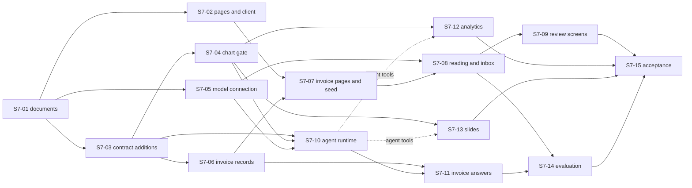

# Spec 7 ticket breakdown

Spec: [Invoice and payments, with chat, dashboards and slides](../../specs/07-invoice-and-payments.md), draft 2026-10-27. Technical plan: [07-invoice-and-payments.md](../../tech-plans/07-invoice-and-payments.md). Beads epic: `genie-ops-center-v2-czjw`. The owner approved this breakdown on 2026-10-27, after a cold critique of the plan and of the tickets. No ticket after S7-01 starts before the owner approves the spec. Beads owns live status, claims and blockers. These documents own ticket scope.

Owner decision, 2026-10-27: full scope for the November 2026 festival, with no slip order.

## Definition of done for every ticket

- The ticket's acceptance criteria pass at a phone and a desktop viewport for every screen (`DEC-25`).
- For UI: documented Storybook stories first, then failing behavior tests, then the code ([UI development workflow](../../architecture/ui-development.md)).
- Pure rules get unit tests. Anything that reads the database gets integration tests on a real Postgres.
- The anti-slop browser scan (`npx impeccable detect`) is clean on every story the ticket touched.
- axe passes on every end-to-end screen the ticket touched.
- A new dependency gets its `../../core/tech-stack.md` line in the same change.
- Gate and end-to-end tests use the recorded test model of S7-05. No test in `pnpm gate:merge` calls a live model.
- `pnpm gate:merge` is green before the merge.

## Tickets

| Ticket | Bead | Depends on | Folded beads | Title |
| --- | --- | --- | --- | --- |
| [S7-01](01-documents-and-fixtures/index.md) | `czjw.1` | none | none | Section 7 documents and fixtures |
| [S7-02](02-module-pages-and-browser-client/index.md) | `czjw.2` | S7-01, `6wz1.32`, `6wz1.40` | none | Module pages and browser client |
| [S7-03](03-module-contract-additions/index.md) | `czjw.3` | S7-01 | `d8l5.22` | Module contract additions |
| [S7-04](04-chart-gate-and-component/index.md) | `czjw.4` | S7-03 | none | Chart write gate and chart component |
| [S7-05](05-model-connection/index.md) | `czjw.5` | S7-01 | none | Model connection and test model |
| [S7-06](06-invoice-records-and-datasets/index.md) | `czjw.6` | S7-03 | none | Invoice records, matching and datasets |
| [S7-07](07-invoice-pages-tenant-and-seed/index.md) | `czjw.7` | S7-02, S7-06 | none | Invoice pages, demo tenant and seed |
| [S7-08](08-reading-job-and-inbox/index.md) | `czjw.8` | S7-05, S7-07 | none | Reading job and Documents inbox |
| [S7-09](09-review-screens/index.md) | `czjw.9` | S7-08 | none | Review screens |
| [S7-10](10-agent-runtime/index.md) | `czjw.10` | S7-03, S7-04, S7-05 | none | Agent runtime, Ask and bubble |
| [S7-11](11-invoice-answers/index.md) | `czjw.11` | S7-06, S7-10 | none | Invoice answers |
| [S7-12](12-analytics-module/index.md) | `czjw.12` | S7-04; tools after S7-10 | none | Analytics module |
| [S7-13](13-slides-module/index.md) | `czjw.13` | S7-04; tools after S7-10 | none | Slides module |
| [S7-14](14-evaluation-suite/index.md) | `czjw.14` | S7-08, S7-11 | none | Evaluation suite and model choice |
| [S7-15](15-acceptance/index.md) | `czjw.15` | all | none | Section 7 acceptance |

## Order

Three lanes run in wave 2: the invoice module (S7-06 to S7-09), the agent (S7-10, S7-11) and the editors (S7-12, S7-13). S7-12 and S7-13 build their editors after S7-04 and add their agent tools after S7-10.
